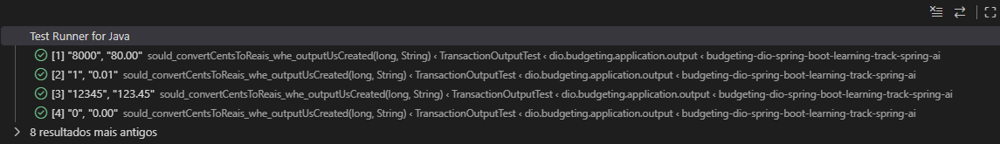
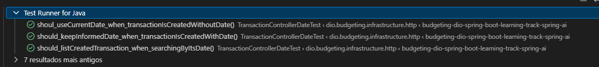

# Budgeting API com Spring AI

API de orçamento que recebe **comandos de voz** sobre gastos financeiros, usa IA para entender a intenção, executa funções reais da aplicação (registrar ou consultar transações) e devolve a resposta **em áudio**.

Desafio de Projeto final da trilha de Spring Boot do bootcamp de Java com Inteligência Artificial da [DIO](https://www.dio.me/).

> **Origem do projeto**
>
> Este repositório é baseado no projeto [`05-spring-ai`](https://github.com/digitalinnovationone/dio-spring-boot-learning-track/tree/main/05-spring-ai) do repositório [digitalinnovationone/dio-spring-boot-learning-track](https://github.com/digitalinnovationone/dio-spring-boot-learning-track), construído nas aulas com o expert Poiani.
>
> A base do código é a do projeto original. Os ajustes de ambiente estão em [Alterações em relação ao projeto original](#alterações-em-relação-ao-projeto-original), e as funcionalidades novas, em [Qual melhoria você implementou](#qual-melhoria-você-implementou).

## Alterações em relação ao projeto original

### Versões

| Item | Original | Este projeto |
|---|---|---|
| Java (toolchain do Gradle) | 25 | **21** (LTS) |
| Spring Boot | 4.0.5 | 4.0.5 |
| Spring AI | 2.0.0-M4 | 2.0.0-M4 |
| Gradle (wrapper) | 9.4.1 | 9.4.1 |
| Plugin Lombok (`io.freefair.lombok`) | 9.2.0 | 9.2.0 |
| MySQL (Docker Compose) | 9.6 | 9.6 |

A única mudança de versão é o **Java 25 → 21**, para usar o JDK instalado no ambiente de desenvolvimento. Não foi preciso alterar código: o projeto só usa recursos disponíveis desde o Java 17 (`record`, `var`, `Stream.toList()`). As demais versões foram mantidas iguais às das aulas.

### Outras alterações

- **Testes no Windows com acento no caminho** (`build.gradle`): quando a pasta do projeto tem caracteres como `ê` (ex.: `Java com Inteligência Artificial`), o `gradlew test` falhava com `ClassNotFoundException`. O Gradle grava o classpath do processo de testes num arquivo em UTF-8, mas o `java.exe` lê esse arquivo no encoding nativo do Windows (Cp1252). A correção gera um *pathing jar* (um JAR cujo manifest lista o classpath em formato URL) numa pasta temporária sem acento. O ajuste **só é ativado no Windows com caminho não-ASCII**; em qualquer outro ambiente o build é idêntico ao original.
- **Chave da OpenAI fora do repositório**: adicionado o `.env.example` como modelo, e o `.env` (com a chave real) entrou no `.gitignore`.
- **README**: traduzido para português, com instruções de execução atualizadas e os links do README raiz da trilha apontando para o GitHub. No original eram links relativos (`../README.md`), que não funcionam fora daquele repositório.

## O que o projeto faz

Fluxo principal do endpoint de IA:

1. O cliente envia um arquivo de áudio.
2. O áudio é transcrito para texto.
3. O modelo escolhe uma ferramenta (*tool*), que corresponde a um caso de uso da aplicação.
4. O caso de uso grava ou consulta transações no banco.
5. A resposta final é convertida em áudio (MP3).

A IA é integrada **sem atravessar as fronteiras do domínio e dos casos de uso**: as mesmas classes de caso de uso atendem tanto os endpoints REST quanto o *tool calling* do modelo.

## Tecnologias

- **Java 21** e **Spring Boot 4.0.5** (Web, Data JPA, suporte a Docker Compose)
- **Spring AI 2.0.0-M4** com OpenAI:
  - `gpt-4o-mini`: chat e *tool calling*
  - `whisper-1`: transcrição de áudio (português)
  - `gpt-4o-mini-tts`: geração de voz (voz `nova`, saída MP3)
- **MySQL 9.6** via Docker Compose
- **Lombok**, **JUnit 5**, **Gradle 9.4.1**

## Estrutura do projeto

- `src/main/java/dio/budgeting/domain`: modelo de domínio e contrato do repositório.
- `src/main/java/dio/budgeting/application`: casos de uso, usados tanto pela API REST quanto pelo *tool calling*.
- `src/main/java/dio/budgeting/infrastructure`: adaptadores HTTP e JPA, e a integração entre as camadas.
- `infrastructure/ai`: ferramentas auxiliares usadas só pela IA (ex.: data atual).
- `src/main/resources/prompts/system-message.st`: prompt de sistema do assistente.
- `src/main/resources/application.properties`: configuração dos modelos de IA.

### Tópicos do módulo

- **Speech-to-text**: `TranscriptionModel` transcreve o áudio. As configurações do modelo ficam no `application.properties`.
- **Tool calling**: o `ChatClient` registra as ferramentas que o modelo pode chamar:

  | Tool | Classe | O que faz |
  |---|---|---|
  | `persist-transaction` | `PersistTransactionUseCase` | registra um gasto (data opcional) |
  | `list-transactions-by-category` | `ListTransactionsByCategoryUseCase` | lista os gastos de uma categoria |
  | `list-transactions-by-date` | `ListTransactionsByDateUseCase` | lista os gastos de uma data |
  | `get-current-date` | `CurrentDateTool` | informa a data de hoje, para interpretar "hoje" e "ontem" |

- **Text-to-speech**: `TextToSpeechModel` gera o MP3 a partir do texto final, e o endpoint de IA devolve esse áudio.

## Como executar

### Pré-requisitos

- JDK 21
- Docker (no Windows, o Docker Desktop precisa estar rodando; pelo terminal: `docker desktop start`)
- Uma chave da API da OpenAI, com créditos, para o endpoint de IA. Os endpoints REST funcionam sem créditos.

### 1. Configurar a chave da OpenAI

Copie o `.env.example` para `.env` e preencha a chave:

```
OPENAI_API_KEY=sua_chave_aqui
```

Depois carregue a variável no terminal:

```bash
# Linux / macOS / Git Bash
set -a; source .env; set +a
```

```powershell
# Windows PowerShell
Get-Content .env | ForEach-Object { if ($_ -match '^\s*([A-Za-z_]\w*)\s*=\s*(.*)$') { Set-Item "env:$($Matches[1])" $Matches[2] } }
```

### 2. Subir a aplicação

```bash
./gradlew bootRun        # Linux / macOS
.\gradlew.bat bootRun    # Windows
```

O suporte a Docker Compose do Spring Boot sobe o MySQL automaticamente, usando o `compose.yml` (porta `3307`). A API fica disponível em `http://localhost:8080`.

## Como testar

### Endpoints

| Método | Rota | Corpo | Resposta |
|---|---|---|---|
| `POST` | `/transactions` | JSON: `description`, `category`, `amount` (**centavos**) e `date` (opcional, `YYYY-MM-DD`) | transação criada |
| `GET` | `/transactions/{categoria}` | — | transações da categoria (`GROCERIES`, `PHARMA` ou `AUTO`) |
| `GET` | `/transactions?date=YYYY-MM-DD` | — | transações da data |
| `POST` | `/transactions/ai` | `multipart/form-data` com o campo `file` (áudio) | áudio MP3 com a resposta |

**Unidades do valor:** na requisição, `amount` vai em **centavos** (`8000` = R$ 80,00). Na resposta, `amount` vem em **reais** (`80.00`).

Exemplo de resposta:

```json
{"id":"4099d89d-2e00-41bb-84af-3ea421f76246","category":"GROCERIES","description":"Mercado","amount":80.00,"date":"2026-11-14"}
```

### Testando as novas funcionalidades

Com a aplicação no ar (os exemplos usam 14/11/2026 como "hoje"):

```bash
# Linux / macOS / Git Bash
curl -X POST http://localhost:8080/transactions -H "Content-Type: application/json" \
  -d '{"description":"Farmacia","category":"PHARMA","amount":4000,"date":"2026-11-10"}'
curl -X POST http://localhost:8080/transactions -H "Content-Type: application/json" \
  -d '{"description":"Mercado","category":"GROCERIES","amount":8000}'
curl "http://localhost:8080/transactions?date=2026-11-10"
curl "http://localhost:8080/transactions?date=10/11/2026"   # formato inválido
```

```powershell
# Windows PowerShell (.Content mostra o JSON exatamente como a API devolve)
(Invoke-WebRequest -UseBasicParsing -Method Post -Uri http://localhost:8080/transactions -ContentType 'application/json' -Body '{"description":"Farmacia","category":"PHARMA","amount":4000,"date":"2026-11-10"}').Content
(Invoke-WebRequest -UseBasicParsing -Method Post -Uri http://localhost:8080/transactions -ContentType 'application/json' -Body '{"description":"Mercado","category":"GROCERIES","amount":8000}').Content
(Invoke-WebRequest -UseBasicParsing "http://localhost:8080/transactions?date=2026-11-10").Content
```

| Cenário | Resultado esperado |
|---|---|
| `POST` com `"date":"2026-11-10"` e `"amount":4000` | `201`, `"amount":40.00`, `"date":"2026-11-10"` |
| `POST` sem `date` e com `"amount":8000` | `201`, `"amount":80.00`, `date` = data atual do servidor |
| `GET /transactions?date=2026-11-10` | `200`, só a transação daquele dia |
| `GET /transactions?date=` com uma data sem gastos | `200`, `[]` |
| `GET /transactions/GROCERIES` | `200`, com `date` e `amount` em reais |
| `GET /transactions?date=10/11/2026` (formato errado) | `400` |
| `GET /transactions` (sem `date`) | `400` |
| `POST` com `"date":"2026-13-45"` (data inválida) | `400` |

#### Pela IA (requer créditos na OpenAI)

Grave um áudio (por exemplo, com o Gravador de Som do Windows) e envie para `/transactions/ai`:

| Frase | Comportamento esperado |
|---|---|
| "Gastei 80 reais no mercado" | registra com a data de hoje; a resposta fala **80 reais** |
| "Ontem gastei 35 reais na farmácia" | consulta `get-current-date` e registra com a data de ontem |
| "Quanto gastei hoje?" | consulta `get-current-date` e depois `list-transactions-by-date` |

### Fluxo com áudio

A pasta `src/test/resources/audio` tem gravações de exemplo: `recording-1.m4a` a `recording-6.m4a`, com gastos de 80, 40, 120, 90, 200 e 60 reais.

```bash
# Linux / macOS / Git Bash
curl -X POST http://localhost:8080/transactions/ai \
  -F "file=@src/test/resources/audio/recording-1.m4a" \
  -o resposta.mp3
```

```powershell
# Windows PowerShell (use curl.exe: no PowerShell 5.1, "curl" é um apelido do Invoke-WebRequest)
curl.exe -X POST "http://localhost:8080/transactions/ai" -F "file=@src/test/resources/audio/recording-1.m4a" -o resposta.mp3
```

Abra o `resposta.mp3` para ouvir a resposta.

### Testes automatizados

Os testes com `@SpringBootTest` sobem a aplicação inteira e precisam de um MySQL acessível. Para isso, suba o banco do `compose.yml` e informe a conexão por variáveis de ambiente:

```bash
# Linux / macOS / Git Bash
docker compose up -d --wait
export SPRING_DATASOURCE_URL=jdbc:mysql://localhost:3307/transaction
export SPRING_DATASOURCE_USERNAME=app
export SPRING_DATASOURCE_PASSWORD=app
./gradlew test
```

```powershell
# Windows PowerShell (carregue também o .env, como no passo 1 de "Como executar")
docker compose up -d --wait
$env:SPRING_DATASOURCE_URL = "jdbc:mysql://localhost:3307/transaction"
$env:SPRING_DATASOURCE_USERNAME = "app"
$env:SPRING_DATASOURCE_PASSWORD = "app"
.\gradlew.bat test
```

| Teste | O que verifica | Precisa de |
|---|---|---|
| `BudgetingApplicationTests` | a aplicação sobe | MySQL + `OPENAI_API_KEY` (qualquer valor) |
| `TransactionOutputTest` | conversão centavos → reais | nada (teste unitário) |
| `TransactionControllerDateTest` | data informada, data padrão e listagem por data, pela API | MySQL + `OPENAI_API_KEY` (qualquer valor) |
| `*IT` (`OpenAiChatModelIT`, `OpenAiChatClientIT`, `ToolCallingIT`, `OpenAiTranscriptionModelIT`, `OpenAiSpeechModelIT`) | integração real com a OpenAI | MySQL + chave **com créditos**. Sem a chave, são ignorados; sem créditos, falham com `429 insufficient_quota` |

Para rodar só os testes criados nesta versão:

```bash
./gradlew test --tests '*TransactionOutputTest' --tests '*TransactionControllerDateTest'        # Linux / macOS
```

```powershell
.\gradlew.bat test --tests '*TransactionOutputTest' --tests '*TransactionControllerDateTest'    # Windows
```

No VS Code, também dá para usar o ▶ ao lado de cada classe de teste.

#### Testes criados

**`TransactionOutputTest`** (`src/test/java/dio/budgeting/application/output`): teste unitário parametrizado da conversão de centavos para reais, sem Spring, banco ou IA.

| Centavos | Esperado |
|---|---|
| `8000` | `80.00` |
| `1` | `0.01` |
| `12345` | `123.45` |
| `0` | `0.00` |

A comparação é feita com `isEqualTo(new BigDecimal(...))`, que também confere as duas casas decimais. Ou seja, `80.00` passa, mas `80` ou `80.0` falhariam.

**`TransactionControllerDateTest`** (`src/test/java/dio/budgeting/infrastructure/http`): testes de integração que chamam a API com MockMvc e passam por todas as camadas, do controller até o banco.

| Cenário | Verificação |
|---|---|
| Criar transação **com** data (`2000-01-15`) | `201` e a mesma data na resposta |
| Criar transação **sem** data | `201` e `date` igual à data atual |
| Criar com data e listar com `?date=` | a lista contém o `id` criado, e todos os itens têm a data pesquisada |

- **`@Transactional` na classe:** cada teste é desfeito (*rollback*) no final, então nada fica gravado no banco. Funciona porque o MockMvc executa a requisição na mesma thread do teste.
- **Data de teste distante (`2000-01-15`):** não se mistura com dados reais.
- **MockMvc montado com `MockMvcBuilders.webAppContextSetup(...)`:** no Spring Boot 4, o `@AutoConfigureMockMvc` fica no módulo `spring-boot-webmvc-test`, que o projeto não usa.

#### Resultados

Execução no VS Code (Test Runner for Java), com todos os testes passando:





### Limitações conhecidas

- **Testes dependem de um MySQL externo** (herdado do projeto original): o suporte a Docker Compose é `developmentOnly` e não vale para os testes. Por isso é preciso subir o banco e definir as variáveis `SPRING_DATASOURCE_*`, como mostrado acima.

## Qual melhoria você implementou

Implementei duas melhorias, um ajuste no controller e testes automatizados. A ideia foi aproveitar a comunicação com a IA que já existia: as novas funcionalidades são casos de uso comuns, expostos em endpoints REST (que testei sem gastar créditos) e registrados como *tools* para a IA usar.

### 1. Data nas transações e consulta por data

**O que mudou:**

- Toda transação passou a ter uma **data** (`LocalDate`, formato `YYYY-MM-DD`). Se ela não for informada no cadastro, a aplicação usa a **data atual do servidor**.
- **Novo endpoint** `GET /transactions?date=YYYY-MM-DD` para listar os gastos de um dia. Os outros endpoints passaram a devolver a data também.
- **Novas tools para a IA:**
  - `list-transactions-by-date`: consulta por data, para perguntas como "quanto gastei hoje?";
  - `get-current-date`: informa a data de hoje, já que o modelo não sabe que dia é e precisa disso para entender "hoje" e "ontem";
  - a `persist-transaction` aceita a data como **opcional**.
- **Prompt de sistema:** uma instrução nova pede ao modelo que consulte a data atual quando o usuário usar datas relativas.

**Decisões:**

- **Regra da data padrão no domínio** (construtor de `Transaction`), e não no controller. Assim, ela vale para qualquer entrada, seja o REST ou a IA.
- **Query param (`?date=`) em vez de `/transactions/{date}`.** A rota `/transactions/{category}` já captura qualquer valor depois da barra, então uma data ali seria interpretada como categoria. O `@DateTimeFormat(iso = DATE)` garante o formato `YYYY-MM-DD` independentemente do idioma do servidor, e um formato inválido devolve `400`.
- **Coluna `transaction_date`**, porque `date` é palavra-chave em SQL. A coluna é criada automaticamente pelo `ddl-auto=update`.
- **Data omitida pela IA quando o usuário não a menciona.** A descrição do parâmetro instrui o modelo a omitir a data nesse caso, porque modelos tendem a inventar datas. Na omissão, vale a regra do domínio.
- **`CurrentDateTool` em `infrastructure/ai`**, e não em `application`. Ela não é regra de negócio nem tem endpoint REST; é só um apoio para o modelo.

### 2. Correção dos centavos

**O problema:** o valor é recebido e guardado em centavos (`8000` = R$ 80,00), mas a resposta mostrava `8000.0`. A conversão só acrescentava casas decimais, sem dividir por 100. Isso aparecia na API e também nas respostas das tools, então a IA podia dizer "8000 reais".

**A correção:**
- A conversão passou a ser feita num único ponto, o `TransactionOutput.from`, com `BigDecimal.valueOf(amount, 2)`. Agora 8000 vira `80.00`.
- O tipo do valor de saída passou de `double` para `BigDecimal`, que é exato para dinheiro e mantém as duas casas decimais.
- Entrada e banco continuam em centavos. Não houve migração, e os registros antigos passaram a ser exibidos corretamente.

### 3. Nomes explícitos nos parâmetros do controller

**O problema:** ao rodar os testes pelo VS Code, o `GET /transactions?date=` falhava com `Name for argument of type [java.time.LocalDate] not specified`. Sem um nome explícito na anotação, o Spring descobre o nome do parâmetro (`date`) por uma informação que o compilador só grava com a opção `-parameters`. O Gradle usa essa opção (configurada pelo plugin do Spring Boot), mas o compilador da extensão Java do VS Code não.

**A correção:** declarar os nomes, `@RequestParam("date")` e `@PathVariable("category")`. Assim os endpoints funcionam em qualquer IDE ou compilador. Isso corrigiu também o `GET /transactions/{categoria}` do projeto original, que tinha o mesmo problema ao rodar pelo VS Code.

### 4. Testes automatizados

Criei dois testes, descritos com os prints da execução em [Testes criados](#testes-criados):

- `TransactionOutputTest`: conversão de centavos para reais (teste unitário, 4 casos);
- `TransactionControllerDateTest`: data informada, data padrão e listagem por data, chamando a API (3 testes de integração).

### Arquivos criados e alterados

| Camada | Arquivo | Mudança |
|---|---|---|
| Domínio | `domain/Transaction.java` | campo `date` e regra da data padrão |
| Domínio | `domain/TransactionRepository.java` | `findAllByDate` |
| Aplicação | `application/ListTransactionsByDateUseCase.java` (novo) | caso de uso e tool `list-transactions-by-date` |
| Aplicação | `application/PersistTransactionUseCase.java` | repassa a data |
| Aplicação | `application/input/PersistTransactionInput.java` | `date` opcional na tool |
| Aplicação | `application/output/TransactionOutput.java` | `date` e conversão centavos → reais (`BigDecimal`) |
| Infraestrutura | `infrastructure/ai/CurrentDateTool.java` (novo) | tool `get-current-date` |
| Infraestrutura | `infrastructure/http/TransactionController.java` | endpoint `?date=`, registro das tools novas e nomes explícitos em `@RequestParam`/`@PathVariable` |
| Infraestrutura | `infrastructure/http/request/TransactionRequest.java` | `date` na requisição |
| Infraestrutura | `infrastructure/http/response/TransactionResponse.java` | `date` e `amount` em `BigDecimal` |
| Infraestrutura | `infrastructure/persistence/entity/TransactionEntity.java` | coluna `transaction_date` |
| Infraestrutura | `infrastructure/persistence/repository/*` | consulta `findAllByDate` |
| Recursos | `prompts/system-message.st` | instrução sobre datas relativas |
| Testes | `src/test/.../application/output/TransactionOutputTest.java` (novo) | conversão centavos → reais |
| Testes | `src/test/.../infrastructure/http/TransactionControllerDateTest.java` (novo) | data informada, data padrão e listagem por data |
| Documentação | `docs/test/screenshots/` (novo) | prints da execução dos testes |

Os testes manuais estão em [Testando as novas funcionalidades](#testando-as-novas-funcionalidades), e os automatizados, em [Testes criados](#testes-criados).

## O que você aprendeu

- **Tool calling na prática:** o modelo decide sozinho qual método chamar, e as descrições de `@Tool` e `@ToolParam` funcionam como instruções para ele. Um parâmetro opcional com a orientação "omita se o usuário não mencionar" evita que a IA invente dados.
- **O modelo não sabe a data de hoje:** para entender "hoje" ou "ontem", foi preciso dar essa informação a ele por meio de uma tool.
- **Camadas bem separadas facilitam evoluir:** o mesmo caso de uso atende o REST e a IA. Por isso consegui desenvolver e testar tudo pelos endpoints, sem gastar créditos. Para a IA usar as funcionalidades novas, basta registrá-las como tools no `ChatClient`.
- **Dinheiro não combina com `double`:** guardar em centavos (`long`) e converter com `BigDecimal` na saída evita erros de arredondamento.
- **Rotas no Spring MVC:** `/{category}` e `/{date}` no mesmo nível conflitam, e o *query param* resolve. O `@DateTimeFormat` garante o formato da data.
- **Ambiente e ferramentas:**
  - ajustar a versão do Java pelo *toolchain* do Gradle;
  - entender por que um caminho com acento quebrava os testes no Windows;
  - descobrir que o erro "não pode encontrar o arquivo" do Docker queria dizer que o Docker Desktop estava parado;
  - manter a chave da API fora do Git com `.env` e `.env.example`.
- **Testes com `@SpringBootTest`:** eles sobem a aplicação inteira, banco incluído, e por isso precisam de um MySQL acessível. Testes que chamam APIs pagas precisam de saldo: sem créditos, a OpenAI responde `429 insufficient_quota`.
- **Testes de API com MockMvc:** `@SpringBootTest` com MockMvc testa o fluxo completo sem abrir uma porta HTTP, e o `@Transactional` no teste desfaz o que foi gravado. No Spring Boot 4, o `@AutoConfigureMockMvc` mudou de módulo, então montei o MockMvc a partir do contexto.
- **O mesmo código pode se comportar diferente conforme o compilador:** o endpoint por data funcionava pelo Gradle e falhava pelo VS Code, porque só o Gradle grava os nomes dos parâmetros no `.class` (opção `-parameters`). Declarar `@RequestParam("date")` deixou o código independente disso.
- **Ler o erro com atenção:** um `400` nos testes parecia ser problema da data, mas era um erro de digitação na categoria (`PHORMA`). O Jackson recusa valores que não existem no enum e a API responde `400` antes de chegar ao caso de uso.

**Próximos passos que eu faria:**
- validações antes de salvar (valor maior que zero, descrição obrigatória);
- consulta por período (de/até);

## Referências

### Documentação do Spring AI

- [Spring AI Reference](https://docs.spring.io/spring-ai/reference/index.html)
- [ChatModel API](https://docs.spring.io/spring-ai/reference/api/chatmodel.html)
- [ChatClient API](https://docs.spring.io/spring-ai/reference/api/chatclient.html)
- [Tools API](https://docs.spring.io/spring-ai/reference/api/tools.html)
- [Audio Transcriptions API](https://docs.spring.io/spring-ai/reference/api/audio/transcriptions.html)
- [Audio Speech API](https://docs.spring.io/spring-ai/reference/api/audio/speech.html)

### Arquitetura (README raiz da trilha original, em inglês)

- [DDD layers](https://github.com/digitalinnovationone/dio-spring-boot-learning-track/blob/main/README.md#ddd-layered-architecture)
- [Class vs record](https://github.com/digitalinnovationone/dio-spring-boot-learning-track/blob/main/README.md#java-class-vs-java-record-in-domain-modeling)
- [Strong typed identifiers](https://github.com/digitalinnovationone/dio-spring-boot-learning-track/blob/main/README.md#strong-typed-identifiers)
- [Repository pattern](https://github.com/digitalinnovationone/dio-spring-boot-learning-track/blob/main/README.md#repository-pattern)
- [Use cases and Clean Architecture](https://github.com/digitalinnovationone/dio-spring-boot-learning-track/blob/main/README.md#use-cases-and-clean-architecture)
- [Docker Compose support](https://github.com/digitalinnovationone/dio-spring-boot-learning-track/blob/main/README.md#docker-compose-support-in-development)
